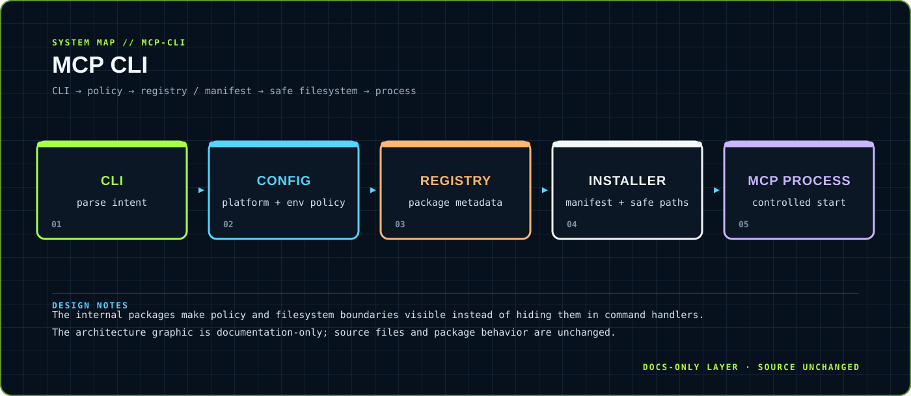

<div align="center">



</div>

# MCP CLI

> A security-conscious Go command line for installing and running MCP packages.

A standard-library-oriented CLI that separates command parsing, configuration, registry metadata, install policy, safe paths and process startup.

<div align="center">

`Go 1.22 · standard library` &nbsp;·&nbsp; `mcp install · mcp search · mcp start`

</div>

## `01 / SYSTEM CARD`

- **Primary boundary:** `CLI → policy → registry / manifest → safe filesystem → process`
- **Documentation stance:** architecture and presentation only; application source is intentionally untouched.
- **Visual language:** Y2K terminal grid, brutalist labels, maximalist contrast, readable static SVG fallback.

## `02 / ARCHITECTURE`

The map above is a compact view of the repository's visible runtime boundary. It is designed to answer three questions quickly: where input enters, where policy or domain logic lives, and where external side effects leave the system.


## `03 / DESIGN NOTES`

- The internal packages make policy and filesystem boundaries visible instead of hiding them in command handlers.
- The architecture graphic is documentation-only; source files and package behavior are unchanged.

This upgrade adds documentation assets only. It does not change source files, dependency manifests, tests, workflows or runtime configuration.

## `04 / EXISTING PROJECT DOCUMENTATION`

<details open>
<summary>Read the original project notes</summary>

# MCP CLI starter

A Go-standard-library CLI with exactly these forms:

```text
mcp install <pkg>
mcp search <query>
mcp start
```

Central names use `name`; GitHub packages use canonical `owner/repo@<40-hex-commit>` syntax (no `.git` suffix). Both are resolved through the fixed HTTPS central registry. The registry response is strict JSON and must provide a SHA-256 for `mcp.json`; the CLI verifies both the downloaded manifest and the checked-out copy against that trusted digest. The decoded manifest name must exactly match the registry's validated package identity, which must in turn match a central-name request.


## Platform support

Runtime installation and advisory locking are supported on **macOS and Linux**. Other operating systems compile for portability checks but return an explicit unsupported-platform error before acquiring the per-user install/config lock. No Windows runtime support is claimed by this starter.
## Cargo is disabled by default

**Cargo installation runs dependency and package `build.rs` scripts as unsandboxed local code. It is therefore rejected by default.** Support remains available only through an explicit risk acceptance for the individual CLI invocation:

```text
MCP_ALLOW_UNSANDBOXED_CARGO=1 mcp install <pkg>
```

This opt-in does not make Cargo safe. Build scripts can access the invoking user's files and network with that user's privileges. Use a dedicated OS sandbox/container with no secrets, a read-only source tree, minimal filesystem access, and restricted network access. The CLI's minimal child environment reduces accidental secret exposure but is not an OS security boundary.

## Security model

- Registry requests and redirects are restricted to explicitly allowlisted HTTPS hosts on port 443. Proxy environment variables are not inherited, DNS results in private, loopback, link-local, multicast, unspecified, carrier-grade NAT, documentation, benchmarking, transition, and reserved ranges are rejected, response sizes are bounded, and JSON rejects unknown/trailing fields.
- Sources are restricted to canonical `https://github.com/<owner>/<repo>` URLs and a full commit. Git runs directly (never through a shell), with a minimal allowlisted environment, prompts disabled, only HTTPS transport allowed, file transport disabled, and hooks redirected to the operating system null device. The resulting commit is checked with bounded verifier output.
- Checked-out and post-install trees are validated. Symlinks, special files, and multiply-linked regular files are rejected; security-sensitive file paths are containment checked. Existing path ancestors are canonicalized before package/config/runtime operations, and command path components beneath package roots may not be symlinks.
- npm requires `package-lock.json` and runs `npm ci --ignore-scripts --no-audit --no-fund`.
- Python requires an exact, SHA-256-hashed `requirements.lock`; pip uses `--require-hashes --only-binary=:all: --no-deps` so source distributions and their build hooks are rejected.
- Cargo requires both explicit opt-in and `Cargo.lock`, then builds with `--locked`; the residual risk above still applies.
- Runtime commands are executed directly without a shell. Children receive only a small allowlist of process essentials plus values named by manifest environment mappings. Arbitrary host variables are excluded, and loader/language-runtime control names are forbidden as mapping sources or targets. Only references—not values—are persisted.
- `~/.mcp/config.json` is size-bounded, strict JSON, a single-link regular file with mode `0600`, and is replaced atomically. `~/.mcp` uses mode `0700`. Installs and registrations share a bounded per-user advisory lock; kernel lock release makes process crashes stale-safe, and the persistent lock file must itself be a single-link regular `0600` file.

This repository includes implementation and local unit tests only. Running the tests does not contact the registry, clone repositories, or install dependencies.

</details>

